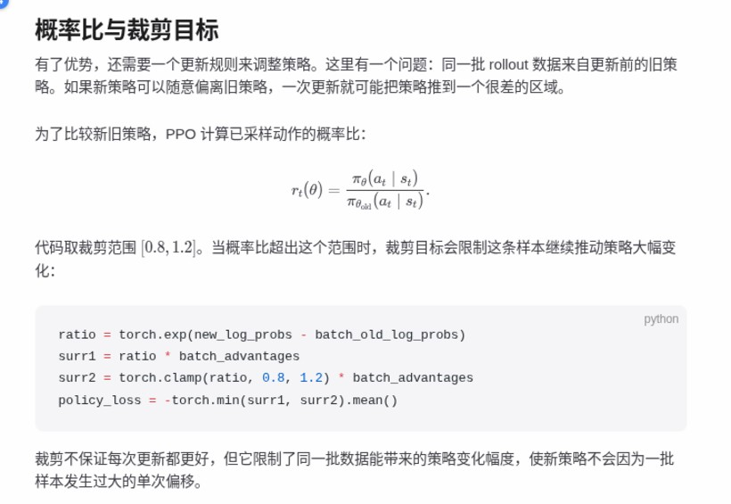
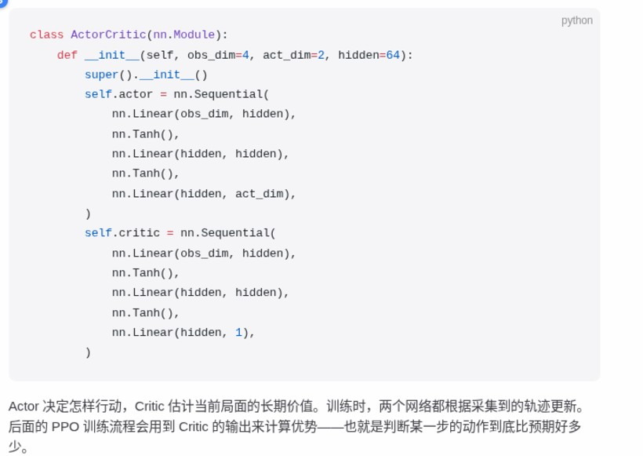
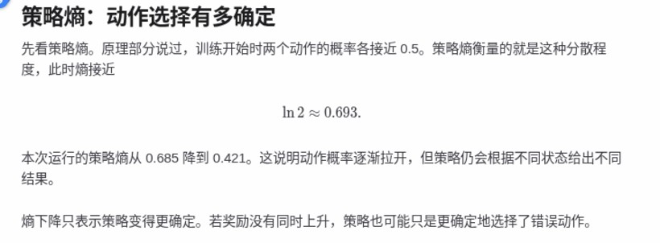
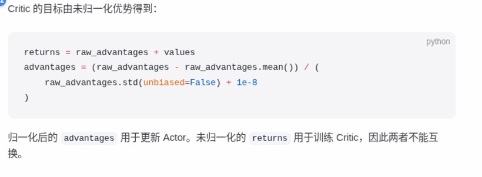

# chapter01_cartpole

> 由 RL Sidekick 自动记录 · 源页面：https://walkinglabs.github.io/hands-on-modern-rl/chapter01_cartpole/metrics

### 2026-11-11 20:04 · 圈选提问 · §PPO 训练流程

**原文**：

> for _ in range(num_steps):
> action, log_prob, value = model.get_action(obs_tensor)
> next_obs, reward, terminated, truncated, _ = env.step(action.item())
> 
> 这段数据称为一段 rollout。它可以包含多个完整回合，也可能在某个回合中间结束。
> 
> 收集完之后，程序要做两件事：先判断每一步的动作比预期好多少（优势），再据此更新策略——但更新的幅度要有限制。


**问**：我理解rollout是当前状态，按照当前策略进行一定步数来收集数据去计算actor critic对吗

**答**：

结论：方向对，但有一个词需要修正——rollout 不是“当前状态”，而是“用当前策略 $\pi_{\theta_{old}}$ 与环境交互采样出的一串 $(s_t,a_t,r_t,s_{t+1})$ 序列”，一共 `num_steps` 步。

几个细节：

1. **采样时**：动作从 $\pi_{\theta_{old}}(\cdot\mid s_t)$ 采样，同时记下 $\log \pi_{\theta_{old}}(a_t\mid s_t)$ 和 $V_{\theta_{old}}(s_t)$——`get_action` 一次返回三元组，就是为后面准备的。

2. **计算优势时，critic 只提供基线和价值估计，并不直接决定优势**。TD 残差
$$\delta_t = r_t + \gamma \hat V(s_{t+1}) - \hat V(s_t)$$
用 GAE 累加得 $\hat A_t$。注意 `terminated=True` 时 $\hat V(s_{t+1})$ 要置零（真终止）；只是 `truncated`（超时截断）则应保留 bootstrap。

3. **更新时**：actor 用 $\hat A_t$ 加权、重要性比率
$$r_t(\theta)=\frac{\pi_\theta(a_t\mid s_t)}{\pi_{\theta_{old}}(a_t\mid s_t)}$$
配合 clip 限制幅度；critic 回归到 $\hat V_\phi(s_t) \leftarrow \hat A_t + \hat V(s_t)$。同一批 rollout 通常跑多个 epoch / minibatch，所以是“近似 on-policy”，才需要 clip。

▸ 一句话记住：rollout 是“用老策略跑一段、存下来给 actor 和 critic 反复练”的经验数据集。

---

### 2026-11-11 23:09 · 圈选提问 · §TD 误差与 GAE 优势

**原文**：

> 概率比与裁剪目标
> 
> 有了优势，还需要一个更新规则来调整策略。这里有一个问题：同一批 rollout 数据来自更新前的旧策略。如果新策略可以随意偏离旧策略，一次更新就可能把策略推到一个很差的区域。
> 
> 为了比较新旧策略，PPO 计算已采样动作的概率比：
> 
> [公式]
> 
> 代码取裁剪范围 [公式] 。当概率比超出这个范围时，裁剪目标会限制这条样本继续推动策略大幅变化：
> 
> ratio = torch.exp(new_log_probs - batch_old_log_probs)
> surr1 = ratio * batch_advantages
> surr2 = torch.clamp(ratio, 0.8, 1.2) * batch_advantages
> policy_loss = -torch.min(surr1, surr2).mean()
> 
> 裁剪不保证每次更新都更好，但它限制了同一批数据能带来的策略变化幅度，使新策略不会因为一批样本发生过大的单次偏移。



**问**：这一段，裁剪。我的理解是：1. rollout数据可以计算出Actor 和Critic 策略，实际表现是得到两个网络的权重。 2. 裁剪就是如果新的pi除以原来的pi, 超过限制就按照最大那个限制来。 疑问：1. 如何得到的两个策略？是BP吗？

**答**：

结论：只有**一个** Actor 网络在反复做 BP，所谓“两个策略”是同一网络在**两个时刻**的参数快照 $\theta_{\text{old}}$（rollout 那一刻，已冻结）与当前正在更新的 $\theta$；旧策略不是第二个网络。

我读到的公式：$$r_t(\theta)=\frac{\pi_\theta(a_t\mid s_t)}{\pi_{\theta_{\rm old}}(a_t\mid s_t)}$$

流程（都不涉及“从数据反推策略”）：
- **Rollout**：用当前 $\pi_{\theta_{\rm old}}$ 采样，同时把 $\log\pi_{\theta_{\rm old}}(a_t\mid s_t)$、$s_t,a_t,r_t$ 和 $V(s_t)$ 存进 batch。这些数只是**前向计算的数值**，不再是网络。
- **更新**：当前 $\pi_\theta$ 重新前向 $\to$ `new_log_probs`（带梯度）；`batch_old_log_probs` 是常量（detach）。于是
$$r_t=\exp\big(\log\pi_\theta-\log\pi_{\theta_{\rm old}}\big)$$
这一步依据是 $\exp(\log a-\log b)=a/b$。
- **裁剪**：$\text{clip}(r,0.8,1.2)$ 把比值夹在边界；再与 $rA$ 取 $\min$，这是**悲观下界**：$A>0$ 时不奖励 $r>1.2$，$A<0$ 时不奖励 $r<0.8$，越界样本梯度直接为 0，等于不推动。
- **谁走 BP**：$\theta$（策略损失）和 Critic 的 $\phi$（对 GAE 回报做回归），旧 log-probs 与优势都是常量。

▸ 一句话记住：旧策略只是 rollout 时存下的 log-prob 快照，BP 只作用在当前网络参数上。

---

### 2026-11-11 23:14 · 圈选提问 · §Critic 与状态价值

**原文**：

> class ActorCritic(nn.Module):
> def __init__(self, obs_dim=4, act_dim=2, hidden=64):
> super().__init__()
> self.actor = nn.Sequential(
> nn.Linear(obs_dim, hidden),
> nn.Tanh(),
> nn.Linear(hidden, hidden),
> nn.Tanh(),
> nn.Linear(hidden, act_dim),
> )
> self.critic = nn.Sequential(
> nn.Linear(obs_dim, hidden),
> nn.Tanh(),
> nn.Linear(hidden, hidden),
> nn.Tanh(),
> nn.Linear(hidden, 1),
> )
> 
> Actor 决定怎样行动，Critic 估计当前局面的长期价值。训练时，两个网络都根据采集到的轨迹更新。后面的 PPO 训练流程会用到 Critic 的输出来计算优势——也就是判断某一步的动作到底比预期好多少。



**问**：那么 critic是不是就是按照GAE判断，那么但是这里我看有两个网络啊。

**答**：

结论：GAE 是**算优势的公式**（没有参数），Critic 是**一个网络** $V_\phi(s)$，GAE 用它的输出；你看到的“两个网络”是 Actor $\pi_\theta$ 和 Critic $V_\phi$ 两个**独立参数**的 Sequential。

要点：
- **GAE 不是网络**，只是 rollout 后对每条轨迹的离线计算：
$$\delta_t=r_t+\gamma V_\phi(s_{t+1})-V_\phi(s_t),\qquad \hat A_t=\sum_{l=0}^{T-t-1}(\gamma\lambda)^l\delta_{t+l}$$
依据是 TD 残差按 $(\gamma\lambda)$ 几何加权求和，权衡偏差与方差。
- **Critic 的职责**只是前向出 $V_\phi(s_t)$，供上式用；它自己不被“GAE 判断”，而是**被 GAE 的结果训练**：目标常取 $\hat R_t=\hat A_t+V_\phi(s_t)$，最小化 $\big(V_\phi(s_t)-\hat R_t\big)^2$。GAE 算完后 detach，是常量。
- **两个 Sequential**：actor 输出 `act_dim` 个 logits，critic 输出 1 个标量；参数不共享，各自前向、各自的损失反传（也可相加后一次 backward，梯度仍分别落到两边）。
- **注意**：若没做 detach，优势里的 $V_\phi$ 会把梯度漏进策略损失，实现上要小心。

▸ 一句话记住：GAE 是公式，Critic 是提供 $V(s)$ 并回归 GAE 回报的那个网络。

---

### 2026-11-11 23:17 · 💡 灵感

> 🧠 我的想法：我懂了，Actor网络是 s->a ， Critic网络是s->V(st)

---

### 2026-11-11 23:20 · 💡 灵感

> 🧠 我的想法：两个可以都看成一种关系，神经网络代表的就是拟合这种关系。根据当前状态，得到action 和 原来的策略得到的Value。所以那句话：PPO用Critic的输出来计算优势，**判断某一步的动作到底比预期好多少**。

---

### 2026-11-11 23:22 · 💡 灵感

> 🧠 我的想法：然后就有，PPO根据TD GAE 得到At。原文：**优势为正时，PPO 会提高这次动作在相同状态下出现的概率；优势为负时，则会降低这个概率。这正是 Critic 存在的意义：它给每一步的动作提供一个比较基准**。

---

### 2026-11-11 23:49 · 圈选提问 · §再看四个辅助指标

**原文**：

> 策略熵：动作选择有多确定
> 
> 先看策略熵。原理部分说过，训练开始时两个动作的概率各接近 0.5。策略熵衡量的就是这种分散程度，此时熵接近
> 
> [公式]
> 
> 本次运行的策略熵从 0.685 降到 0.421。这说明动作概率逐渐拉开，但策略仍会根据不同状态给出不同结果。
> 
> 熵下降只表示策略变得更确定。若奖励没有同时上升，策略也可能只是更确定地选择了错误动作。



**问**：策略熵是啥？公式是啥？如何计算？以及随着运行如何变化？

**答**：

我读到的公式：$$\ln 2 \approx 0.693$$

**是什么**：策略熵度量某状态下动作分布的分散/不确定程度，单位 nat（自然对数）。

**公式与推导**（依据熵定义 $H=-\sum p\ln p$）：
$$H(\pi(\cdot|s))=-\sum_a \pi(a|s)\ln\pi(a|s)$$
两动作各 0.5 时：
$$H=-\big(0.5\ln 0.5+0.5\ln 0.5\big)=-\ln 0.5=\ln 2\approx 0.693$$
（用了 $\ln 0.5=-\ln 2$，即两个等概率动作给出最大熵，也是"最不确定"的上限。）

**怎么算**：两种写法——①全分布：对网络输出的所有动作概率逐项求和；②蒙特卡洛单样本：$-\ln\pi_\theta(a_i|s_i)$，$a_i\sim\pi_\theta(\cdot|s_i)$，因熵本身就是该量的期望（期望的线性性/定义），故无偏但方差大。实操对 batch 的状态取平均。

**怎么变**：本次 0.685 → 0.421。(a) 起点略低于 0.693，因初始输出并非严格均匀；(b) 下降约 0.26 nat，说明 logits 被拉开、策略更确定；(c) 未到 0，说明仍保留一定随机性且随状态不同。

注意原文提醒：熵降≠策略变好，可能只是更确定地选错动作，需配合奖励一起看。

▸ 一句话记住：策略熵就是 $-\sum_a\pi\ln\pi$，均匀时最大值为 $\ln 2$，下降只说明“更确定”，不代表“更正确”。

---

### 2026-11-11 23:52 · 💡 灵感

> 🧠 我的想法：所以策略熵只有最大ln2，其他都在下降，也不可能下降到0，但下降是对的，代表策略确定了。需要看奖励是否也上升了。

---

### 2026-11-11 23:57 · 圈选提问 · §价值损失：Critic 的预测误差

**原文**：

> 近似 KL：新旧策略相差多大
> 
> 第三个指标对应裁剪目标之前的概率比。近似 KL 比较更新前后的动作概率，数值越大，表示一次 PPO 更新使策略发生的变化越大。
> 
> 本次 40 轮中的最大值为 0.00871，最后一轮为 0.00038。仓库代码没有根据 KL 提前停止训练，因此本页只报告实测值，不给出一个适用于所有任务的固定阈值。


**问**：这里KL如何计算呢？他和裁剪比例应该是类似走向吧。我理解KL越小代表策略变化越小。

**答**：

对，KL 越小说明策略变化越小；它和裁剪比例同向变化，但并不线性——KL 约等于 $(r-1)$ 的平方量级（$r$ 为概率比）。

截图和圈选里都没给公式，下面给 PPO 仓库通行的算法（CartPole 这份 PPO 里常见的是 k3 估计）：

1. 记概率比为重要性权重 $r_t=\dfrac{\pi_\theta(a_t|s_t)}{\pi_{\theta_{old}}(a_t|s_t)}$。
2. 精确 KL：$D_{KL}(\pi_{old}\|\pi_\theta)=\mathbb{E}_{a\sim\pi_{old}}\!\left[\log\frac{\pi_{old}}{\pi_\theta}\right]=\mathbb{E}_{\pi_{old}}[-\log r]$。
3. 但 $- \log r$ 的样本方差大，于是改用 k3 估计：
$$\widehat{KL}=\frac{1}{N}\sum_{t=1}^{N}\left(r_t-1-\log r_t\right)$$
依据是期望的线性性加重要性采样：$\mathbb{E}_{\pi_{old}}[r]=1$（权重归一），故

$$\mathbb{E}_{\pi_{old}}[r-1-\log r]=1-1+D_{KL}(\pi_{old}\|\pi_\theta).$$

它是无偏的，且方差比直接用 $-\log r$ 小。

和裁剪的关系：当 $r$ 在 $1$ 附近时，展开 $\log r$ 得

$$r-1-\log r\approx \tfrac12 (r-1)^2 .$$

所以两者**同向**，但 KL 是二阶小量：小幅更新时 KL 显得更小（你的 $0.00871$ 对应 $|r-1|\approx0.13$，还没到常见的 clip 阈值 0.2），而一旦越过裁剪阈值，KL 就会因平方关系涨得很快。

▸ 一句话记住：KL 是“概率比偏离 1 的平方”，同向但比 clip 更敏感于大变化。

---

### 2026-11-12 10:47 · 圈选提问

**问**：补充知识点：熵 KL 等有关概率，数学在强化学习的知识点作为补充。尽量从定义讲。我感觉他是吧数学部分内容直接用了，但是我没有了解过。

**答**：

结论：这几个量背后只有三件数学基础：**期望与重要性采样**、**熵**、**KL**；PPO 里出现的 ratio、advantage、clip 都是它们的组合。按你要求从定义讲，下面会略超 350 字。

**1. 期望（一切的地基）**
离散分布 $\pi(a\mid s)$ 下 $E_\pi[f]=\sum_a \pi(a\mid s)f(a)$。线性性：$E[aX+bY]=aE[X]+bE[Y]$，**不要求独立**——后面每一步拆项都靠它。

**2. 熵**
$$H(\pi(\cdot\mid s))=-\sum_a\pi(a\mid s)\log\pi(a\mid s)=E_\pi[-\log\pi]$$
- 取最大值的依据是 Jensen 不等式（$\log$ 为凹函数，$E[\log X]\le\log E[X]$）：
$$H=\sum_a\pi_a\log\tfrac{1}{\pi_a}\le\log\sum_a\pi_a\cdot\tfrac{1}{\pi_a}=\log n$$
CartPole 有两个动作，所以上限是 $\ln 2$。
- 熵无法降到 0：softmax 给每个动作的概率永远 $>0$，只有 logits 趋于 $\pm\infty$ 时，概率才会趋于 one-hot，所以熵只能“接近” 0。

**3. KL 散度**
$$D_{KL}(p\|q)=\sum_a p(a)\log\frac{p(a)}{q(a)}=E_p\Big[\log\tfrac{p}{q}\Big]$$
- 由 Jensen 不等式得 $D_{KL}\ge 0$，等号当且仅当 $p=q$；它是非对称的，所以不是距离。
- PPO 里 $D_{KL}(\pi_{\text{old}}\|\pi_\theta)$ 衡量“策略挪了多远”。常用 k3 估计：$D\approx E_{\pi_\theta}[(r-1)-\log r]$，$r=\pi_\theta/\pi_{\text{old}}$，低方差无偏。

**4. 重要性采样（ratio 的出处）**
$$E_{\pi_{\text{old}}}[f]=\sum_a\pi_{\text{old}}f=\sum_a\pi_\theta\frac{\pi_{\text{old}}}{\pi_\theta}f=E_{\pi_\theta}\Big[f\tfrac{\pi_{\text{old}}}{\pi_\theta}\Big]$$
PPO 用的是倒数 $r_t(\theta)=\frac{\pi_\theta}{\pi_{\text{old}}}$，因此可以用旧策略采样出的数据来估计新策略的目标。

**5. log-derivative trick（策略梯度的出处）**
由 $\nabla_\theta\log\pi_\theta=\frac{\nabla_\theta\pi_\theta}{\pi_\theta}$ 得 $\nabla_\theta\pi_\theta=\pi_\theta\nabla_\theta\log\pi_\theta$：
$$\nabla_\theta E_{\pi_\theta}[R]=\sum_a\nabla_\theta\pi_\theta R=E_{\pi_\theta}[R\,\nabla_\theta\log\pi_\theta]$$
（第一步用期望的线性性把梯度移入求和。）

**6. 衡量优劣的基准与优势**
对任意只依赖状态的基线 $b(s)$：$E_\pi[b\nabla\log\pi]=b\sum_a\nabla\pi_\theta=b\nabla_\theta 1=0$，所以减基线不改变梯度期望，却能降低方差。取 $b=V$ 就是优势 $A=Q-V$。前面的 PPO 中，优势为正就提高该动作概率，依据就在这里。

▸ 一句话记住：期望给骨架，熵度量“有多随机”，KL 度量“挪了多远”，ratio 来自重要性采样，advantage 是减了基线的策略梯度。

---

### 2026-11-12 11:41 · 💡 灵感

> 🧠 我的想法：rollout 是固定容量缓存；episode 结束就 reset 继续填，直到 rollout 填满再更新。跨 episode 不需要继承回报，但要用 done/truncated 正确隔断 GAE；episode 跨 rollout 时用 bootstrap 继承价值估计；RNN hidden state 在 episode 边界必须 reset。max_episode_steps 是单 episode 交互步数上限，不是总训练步数。

---

### 2026-11-12 12:10 · 圈选提问

**问**：[object PointerEvent]

**答**：

第三个圈选事件仍然是 `[object PointerEvent]`，里面没有选区文本，因此我读不到你圈的内容。

如果你使用的是阅读器/插件，那么圈选事件只是把事件对象传了过来，并没有把 `selection.toString()` 一并传过来。这是我这边无法修复的环节，麻烦你换成下面两种方式：
- 直接粘贴：在页面上拖选后按 `Ctrl+C`，再粘贴给我（1.3 节的代码块尤其建议这样做）；
- 或者发截图，我会先用「我读到的公式：$$...$$」回报，若符号有误，你可以立刻纠正。

▸ 一句话记住：事件对象转成字符串后只剩类名，文字必须由你复制给我。

---

### 2026-11-12 12:10 · 💡 灵感

> 🧠 我的想法：“batch 是一次参数更新样本，是 rollout 数据”
✅ 对，但更准确：mini-batch 是从 rollout 里切出来的一次参数更新用的 64 个 transition。

“rollout 是 2048 的意思是我理解是 2048 次环境交互产生的数据”
✅ 单环境下对；多环境下是 2048 × n_envs 次交互。

---

### 2026-11-12 12:27 · 圈选提问 · §计算 GAE <!-- id:mwd1qhko0ist7 -->

**原文**：

> Critic 的目标由未归一化优势得到：
> 
> returns = raw_advantages + values
> advantages = (raw_advantages - raw_advantages.mean()) / (
> raw_advantages.std(unbiased=False) + 1e-8
> )
> 
> 归一化后的 advantages 用于更新 Actor。未归一化的 returns 用于训练 Critic，因此两者不能互换。



**问**：这个不理解。就是我理解是actor和critic应该是训练出 s->a s->v(s)的这种网络，输入s对应的obs,输出概率和v。 但是这里代码是说的我看是一个数啊，他网络输入不是obs。

**答**：

结论：那两行不是“标量运算”，而是对**整个 rollout batch 张量做逐元素**运算——每个元素对应一个 $(t,\ \text{env})$ 样本；网络输入确实还是 obs，只是这一步在 obs 之外做“账本计算”。

**形状与来源**

- rollout 阶段每步存下 `obs, act, logp, value`（`value` 是 critic 前向、无梯度）。形状都是 `[T, N]`（T 步 × N 个并行环境）。
- GAE 逆序递推，得到的 `raw_advantages` 形状仍是 `[T, N]`，不是单个数值：

$$\hat A_t=\delta_t+\gamma\lambda\,\delta_{t+1}+\cdots,\qquad \delta_t=r_t+\gamma V(o_{t+1})-V(o_t)$$

- `returns = raw_advantages + values` 是**逐元素**相加，得到 TD(λ) 回报目标 $\hat G_t=\hat A_t+V(o_t)$，形状 `[T, N]`。

**Critic 最终还是吃 obs**

$$\mathcal L_{\text{critic}}=\frac{1}{TN}\sum_{t,n}\big(V_\theta(o_t)-\hat G_t\big)^2$$

`returns` 只是这条回归的**标签**，梯度回传仍经过 $V_\theta(o_t)$，所以网络输入仍是 obs、输出仍是 $V(o)$。你看到的“一个数”，其实是张量里的一项。

**为什么不能互换**

`returns` 是真实回报尺度，归一化会让 critic 学错基准值；`advantages` 只进 actor 的损失 $\min(\rho\hat A,\ \text{clip}(\rho)\hat A)$，做零均值单位方差只是降方差，不改变策略方向。

▸ 一句话记住：`returns` 是给 critic 的回归标签（保持原尺度），`advantages` 是给 actor 的优势权重（归一化降方差），两者都是 `[T,N]` 张量，逐元素算。

---

### 2026-11-12 12:47 · 提问 <!-- id:mwd2gz1awnec1 -->

**问**：就是transitions是参数，是个张量。得到的advantage和return在ppo_update里是张量。transitions.append({
            "obs": obs,
            "action": action.item(),
            "log_prob": log_prob.item(),
            "value": value.item(),
            "reward": float(reward),
            "terminated": terminated,
            "truncated": truncated,
            "next_value": next_value,
        })  ```然后这个是代码，这个网络是4*64*64*1的，那么这个transition只取第一项吗

**答**：

结论：4 是 **obs 的维度**（CartPole 的 $[x,\dot x,\theta,\dot\theta]$），不是 batch；`4-64-64-1` 是 MLP 结构，整批输入，绝不“只取第一项”。

**这套数据结构长什么样**

- `transitions` 是 **长度为 T 的 list of dict**，每项对应一个时间步；`obs` 形如 `[4]`（单环境）或 `[N,4]`（并行 N 环境）。
- `.item()` 只作用在**标量**上：`action`、`log_prob`、`value`、`reward` 都是 `[1]` 或 `[]` 张量，`.item()` 把它变 Python 数，便于存 list。
- `next_value` 是 bootstrap 用的 $\gamma V(o_{t+1})$，同样是标量。

**到 ppo_update 时怎么变成张量**

按时间维 stack：

$$\text{obs}\in\mathbb R^{T\times 4},\quad \text{value},\text{adv},\text{ret}\in\mathbb R^{T\times 1}$$

前向就是 $V_\phi(\text{obs})$：输入 `[T,4]` → 隐层 64 → 64 → 输出 `[T,1]`。每个样本输出一个 $V$，T 个样本一次算完，对应上一轮说的 `[T,N]` 张量的 T 轴。

**“只取第一项”是误区**

- `.item()` 只剥掉长度为 1 的维度，不丢数据；长度 4 的 obs 没被 `.item()`。
- 网络吃的是整批 `[T,4]`，`4` 是特征维，最后一层 `1` 才是输出维（value 是标量）。
- 若真是单环境且 `batch=1`，那 `[1,4]` 确实只有一个样本——但这是 batch 大小，不是取字典的某一项。

不确定的点：你这版代码是否并行多环境、`obs` 存在 `[1,4]` 还是 `[4]`，我看不到源码；回看 § 计算 GAE 里 rollout 收集那段确认形状。

▸ 一句话记住：4 是 obs 维度、T 是样本数，`.item()` 只把标量张量转成 float，ppo_update 里 stack 成 `[T,4]` 整批过网络。

---

### 2026-11-12 12:49 · 提问 <!-- id:mwd2jp13qn8m7 -->

**问**：能够我问的是，这里transition明显是个dist, 实际训练的时候actor和critic网络的输入到底用的什么。

**答**：

结论：网络的输入**只有 `obs`**；dict 里其他字段是训练时“当作标签/系数”用的，不进网络。

**各字段的角色**

- `obs` → **唯一输入**，stack 成 `[T,4]`，喂给 actor 和 critic（CartPole 常共享或分两个 MLP）。
- `action` → 标签，只用来索引 actor 输出的 logits 里对应那一个，算 $\log\pi_\theta(a_t|o_t)$，**不输入**。
- `log_prob` → rollout 时旧策略的值，只用于算比率 $\rho=\pi_\theta/\pi_{\text{old}}$，是常量。
- `value` → 旧 critic 的估计，用于 GAE 已经算好了；训练时 critic **重新前向**得到 $V_\phi(o_t)$，与 `returns` 做 MSE。
- `reward / done` → 只在 GAE 递推时用过，更新阶段不用。

**训练时的实际调用**

$$\log\pi_{\text{new}},\ V_{\text{new}}=\text{net}(\text{obs})$$

- actor loss：

$$\mathcal L_\text{actor}=-\mathbb E\big[\min(\rho\,\hat A,\ \text{clip}(\rho,1-\epsilon,1+\epsilon)\hat A)\big],\quad \rho=\frac{\exp(\log\pi_{\text{new}})}{\exp(\text{log\_prob})}$$

- critic loss：

$$\mathcal L_\text{critic}=\mathbb E\big[(V_{\text{new}}-\text{returns})^2\big]$$

依据：重要性采样给出 $\rho$，控制变量给出优势 $\hat A$；梯度只经 $\pi_\theta(\cdot|o)$ 和 $V_\phi(o)$，不经 `action/log_prob/value` 这些记录值。

**一句话区分**：dict 是“历史记录”，训练时 `obs` 是输入，`action/log_prob/returns` 是计算损失时要对齐的常量。

▸ 一句话记住：网络永远只吃 `obs`，其余字段都是算 loss 时的“对账常量”。

---

